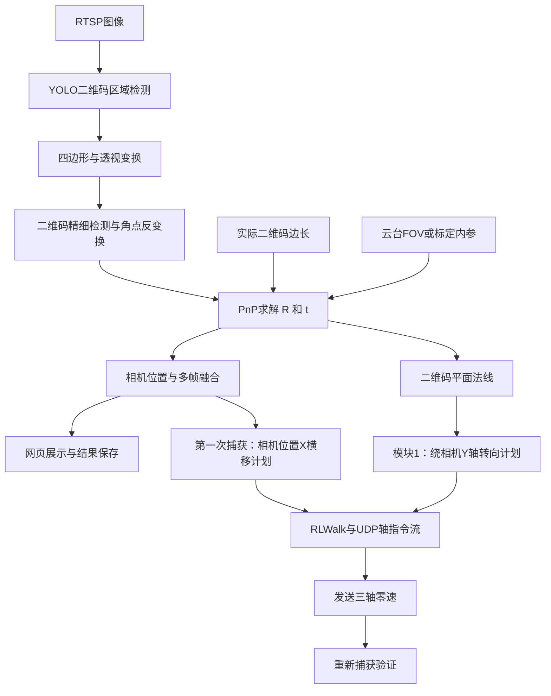
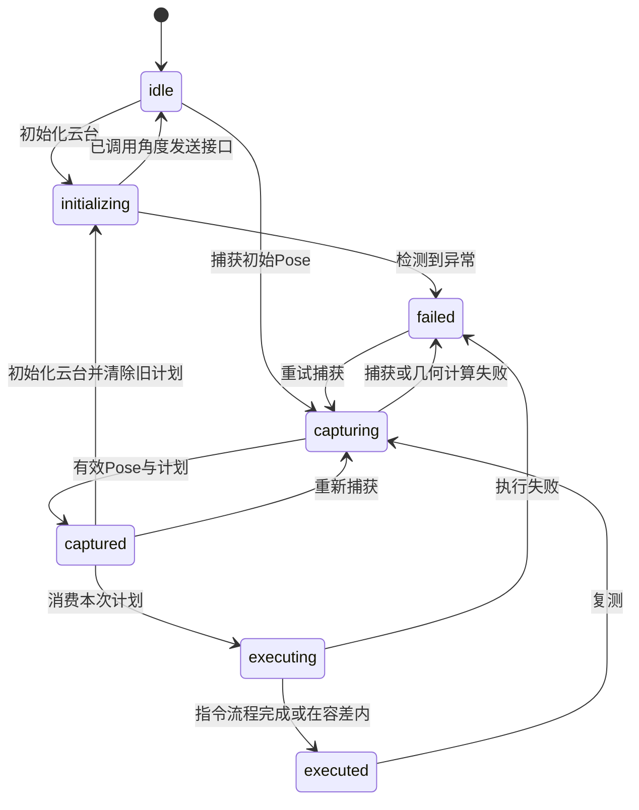
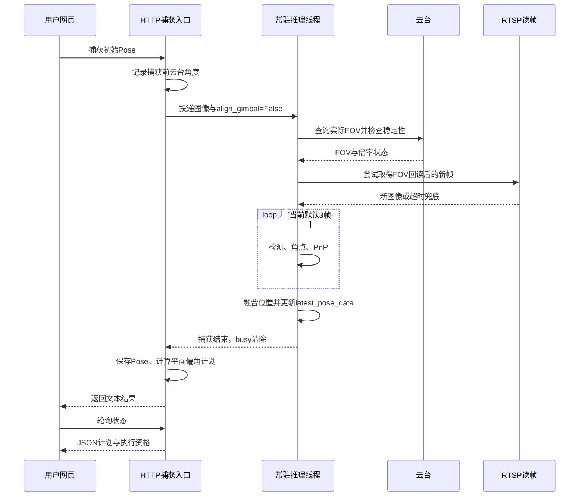

# 二维码视觉定位与机器狗辅助导航功能报告

**编写日期：2026年10月19日**  
**工程：QR_ASCEND**  
**主入口：`gimbal_qr_dog_auto_drive_2.py`**  
**说明：本文以当前工作区代码为依据，分别说明已实现功能、实际操作、算法和现有限制。文中的计算示例是理论示例，不代表现场精度测试结果。**

**阅读导航**：第1—5节介绍系统、功能与操作；第6—10节解释坐标与核心算法；第11—15节说明配置、误差和验证；第16—24节提供进一步的数学推导、端到端算例、状态机与接口、线程时序、故障排查、实验记录模板及维护说明。

## 1. 系统目标与适用范围

本系统通过云台可见光相机观测一个已知物理尺寸的二维码，估计相机相对于二维码的位置和姿态，并将部分位姿信息用于机器狗的方向调整、横向移动以及云台取景调整。

系统采用“二维码作为局部参考物”的定位方式。二维码中心是局部坐标原点，二维码所在平面是参考平面。定位结果描述相机与该二维码的相对关系；当前没有把二维码坐标接入地图坐标或全局定位系统。

系统目前包含三个主要层次：

1. **视觉定位层**：图像采集、二维码检测、角点提取、相机内参更新、PnP位姿估计及结果展示。
2. **网页交互层**：页面1用于相机和机器狗手动操作，页面2用于初始朝向定位和两次捕获导航。
3. **运动执行层**：将视觉计算得到的横移量或转角转换成机器狗的UDP轴指令序列。

当前实现是“视觉测量后执行一次运动，再重新测量”的辅助导航方式。运动执行过程没有接入实际里程、实际转角反馈，不能视为连续视觉闭环或具有到位反馈的定位控制系统。

## 2. 硬件与软件组成

### 2.1 硬件及通信

| 组成 | 当前常用地址或接口 | 作用 |
|---|---|---|
| 云台可见光相机 | `192.168.1.99` | 提供二维码图像 |
| 云台控制 | `192.168.1.99:6001` | 角度设置、变倍、状态及FOV查询 |
| 视频流 | `rtsp://192.168.1.99:554/ch1/stream0` | 实时图像输入 |
| X30运控主机 | `192.168.1.103:43893`，UDP | 接收模式和三轴运动指令 |
| 推理和网页主机 | 以实际部署设备IP为准 | 运行Python程序、Ascend模型和HTTP服务 |
| 浏览器 | HTTP默认端口`5003` | 展示图像、位姿与操作按钮 |

网络中出现的`.106`设备地址与当前驱动实际发送的`.103:43893`不能混为一谈。判断控制目标时，以终端打印的`dog._addr`及运控接收端为准。

### 2.2 软件能力

当前路径使用Python、NumPy、OpenCV、Flask、Ascend推理运行环境及二维码检测模型。二维码精细检测默认采用OpenCV，也保留`pyzbar`选项；后者依赖对应运行库。

模型通常为`models/qr_yolov8.om`。模型文件负责检测二维码区域，位姿解算由后续的几何算法完成，不能直接把模型检测框当成三维坐标。

## 3. 功能清单

| 功能 | 输入 | 输出或动作 | 当前行为说明 |
|---|---|---|---|
| 实时视频 | RTSP图像 | 网页MJPEG视频 | 视频刷新与Pose计算是不同流程 |
| 二维码区域检测 | 图像、Ascend模型 | 检测区域、置信度 | 当前单帧处理第一个检测结果 |
| 二维码角点提取 | 检测区域 | 原图四角点、可选解码内容 | 精细检测失败时可退回YOLO四边形 |
| 三维位姿估计 | 四角点、实际边长、内参 | `R`、`t`、相机位置、距离和角度 | 使用单目已知尺寸目标求解 |
| 多帧捕获 | 一次触发后的多帧图像 | 融合位置和本次测量结果 | 当前默认窗口为3帧 |
| FOV更新 | 云台FOV、图像尺寸 | 本次捕获使用的内参 | 先查询、稳定采样，再锁定本次窗口内参 |
| 二维/三维展示 | 位姿、图像 | 检测投影图、3D场景、文本 | 展示结果有单帧和融合结果之分 |
| 页面1遥控 | 手动按钮或按住方向键 | 模式及轴指令 | 用于独立验证机器狗操作 |
| 模块1云台初始化 | 用户点击 | Yaw/Pitch/Roll均为0°的指令 | 清除模块1旧计划，停稳后重新捕获 |
| 模块1初始Pose捕获 | 二维码图像 | 绕相机Y轴偏角 | 捕获过程中不主动调整云台角度 |
| 模块1执行朝向对齐 | 已捕获偏角 | RLWalk准备、分段转向、零速 | 每份捕获计划只能执行一次 |
| 两次捕获横移流程 | 第一次Pose、第二次Pose | 横移、重测、云台居中和变倍 | 与模块1分别操作 |

“向二维码前进到安全距离”是后续需求，当前模块1尚未实现。

## 4. 软件流程与文件组织



| 文件 | 主要职责 |
|---|---|
| `gimbal_qr_dog_auto_drive_2.py` | 解析启动参数、创建估计器、注入共享对象、启动HTTP与视频 |
| `gimbal_pose_estimation_ascend.py` | 图像与云台操作、检测和位姿计算、多帧采集、页面1及结果输出 |
| `qr_detection.py` | 四角点排序、透视变换、二维码检测和角点反变换 |
| `pose_estimation.py` | 二维码三维角点、相机内参、PnP和投影绘制 |
| `qrnav_initial.py` | 模块1的云台初始化、平面偏角计算、捕获与转向执行 |
| `qrnav_geometry.py` | Pose到导航参数的换算、二维码占比及几何报告 |
| `qrnav_config.py` | 页面2配置及共享状态 |
| `qrnav_phases.py` | 两次捕获、横移阶段、云台居中变倍和一键流程 |
| `qrnav_dogctl.py` | 分段横移、RLWalk准备及控制入口衔接 |
| `qrnav_stream.py` | 页面2图像与位姿同步 |
| `qrnav_steps.py` | 导航辅助步骤 |
| `qrnav_web.py` | 页面2HTML、JavaScript及HTTP接口 |
| `robot_interface.py` | X30 UDP协议、心跳、轴指令流、零速及模式操作 |

## 5. 使用方法

### 5.1 启动前准备

1. 确认运行设备可以访问云台视频、云台控制端口和机器狗运控主机。
2. 确认Ascend环境、Python依赖和`.om`模型可用。
3. 将二维码固定在平整表面，保证四角完整可见，尽量避免反光、弯曲和运动模糊。
4. 测量**用于角点匹配的二维码正方形实际边长**，单位为米。测量范围必须与检测得到的四角定义一致，不能随意把纸张外框、白色静区和码面混用。
5. 模块1使用前，将云台初始化，使相机默认方向与狗身方向一致，等待机械运动和视频画面稳定。

### 5.2 启动命令

在部署设备的工程目录执行：

```bash
cd /root/hjl/QR_ASCEND
python3 gimbal_qr_dog_auto_drive_2.py \
  --mode video \
  --model models/qr_yolov8.om
```

浏览器访问：

```text
页面1：http://<运行Python程序的设备IP>:5003/
页面2：http://<运行Python程序的设备IP>:5003/qr_nav2
```

终端输出的`0.0.0.0:5003`表示服务监听地址。其他设备浏览器应使用运行主机的实际IP。

启动过程会创建机器狗控制对象；当前入口不会因为程序启动就自动发送起立或运动指令。

### 5.3 页面1：手动验证与定位查看

页面1用于独立操作云台、查看图像和位姿，并验证机器狗控制通路。

机器狗遥控建议按界面流程执行：起立，等待约3秒；力控，等待约2秒；开始运动；选择RL行走，等待约4秒后发送方向指令。开始/停止运动属于切换操作，重复点击可能改变到相反状态。

按住方向控制与固定距离单步是两种操作：前者按住期间持续发送摇杆量，松开归零；后者按设置步长换算持续时间。短按方向按钮只能形成很短的指令流，不能据此判断固定距离动作效果。

捕获后查看：

- 图像中的二维码边界和三维坐标轴是否与真实二维码对应。
- 相机位置X、Y、Z及距离是否合理。
- 当前FOV、内参来源和检测置信度是否正常。
- 页面3D场景是否与实际相对位置相符。

页面1的常规捕获路径可能在生成“对齐结果”时实际转动云台，详见第12节；不能把所有捕获按钮都当作纯测量按钮。

### 5.4 页面2模块1：初始朝向定位

推荐操作顺序：

1. 点击**初始化云台（0° / 0° / 0°）**。
2. 等待云台停止转动、图像稳定。
3. 点击**捕获初始Pose**。
4. 查看“绕相机Y轴偏角”、计划方向及转角。
5. 点击**执行朝向对齐**。
6. 等待转向指令执行并归零后，再次捕获，观察残余偏角。

初始化按钮发送Yaw、Pitch、Roll均为0°的角度目标，并清除模块1旧Pose及执行资格。界面返回“已发送”不等于机械角度已经到位，仍需等云台停稳。

模块1捕获通过`align_gimbal=False`关闭共享捕获流程里的云台居中动作。捕获只测量和生成计划，不为让二维码中心落在图像中心而移动云台。

执行时使用这一份捕获结果的冻结计划，不临时读取其他页面的最新Pose。转向采用RLWalk路径，单段默认不超过30°，段末发送零速。一份计划执行后需重新捕获，避免把相同偏角重复执行。执行朝向对齐时，旧的两次捕获导航数据会被清除。

模块1只调整偏航，不自动前进，不补偿二维码平面的俯仰倾斜。

### 5.5 页面2：两次捕获与横移取景

在初始朝向调整后，需要横移和优化取景时，执行原有两次捕获流程：

1. 点击**第一次捕获**，保存第一份Pose。
2. 点击**执行横移**。程序取第一份Pose的`camera_position[0]`计算横移方向与距离，准备RLWalk并发送分段横移指令，最后归零。
3. 等待狗身及图像稳定。
4. 点击**第二次捕获**，重新估计移动后的Pose。
5. 点击**执行云台+变倍**，根据第二份Pose调整图像中的二维码中心位置，并按占比进行变倍。

也可使用原有“一键完成”入口运行其初始化、捕获、横移、等待、第二次捕获及云台变倍流程。**模块1尚未串入该一键流程**，初始朝向调整需要单独操作。

“重置”用于清空导航阶段和捕获数据；机器狗停止、趴下和断开属于另外的控制动作。零速停止与趴下不是同一操作。

## 6. 坐标系与数据含义

### 6.1 二维码坐标系Q

二维码中心作为原点，二维码位于`Zq=0`平面。物理边长为`s`，四个三维角点按照左上、右上、右下、左下定义：

```text
P0 = (-s/2, +s/2, 0)
P1 = (+s/2, +s/2, 0)
P2 = (+s/2, -s/2, 0)
P3 = (-s/2, -s/2, 0)
```

图像角点与物理角点必须一一对应。若角点顺序错误，可能产生旋转翻转、坐标方向异常或平面姿态跳变。

### 6.2 相机坐标系C

采用相机坐标约定：X向图像右侧，Y向图像下侧，Z沿相机光轴向前。

相机视平面可理解为垂直于光轴的平面，其法线为：

```text
nc = (0, 0, 1)
```

模块1提到的“绕Y轴”指相机坐标系Y轴。只有初始相机与狗身朝向及安装轴关系满足约定时，这个角度才能直接作为狗的地面转向目标。

### 6.3 PnP结果与相机位置

PnP求解的是二维码点从Q系到C系的刚体变换：

```text
Pc = R × Pq + t
```

其中，`R`为旋转矩阵，`t`为二维码原点在相机坐标系中的位置。

相机光心在二维码坐标系中的位置为：

```text
Cq = -Rᵀ × t
```

程序中的`camera_position`就是`Cq`。因此：

| 字段 | 含义 |
|---|---|
| `rvec` | OpenCV旋转向量；不是三个可直接相加的欧拉角 |
| `rmat` | 二维码坐标到相机坐标的旋转矩阵R |
| `tvec` | 二维码原点在相机坐标系中的位置t |
| `camera_position` | 相机光心在二维码坐标系中的位置Cq |
| `distance` | `‖Cq‖`，即相机到二维码中心的欧氏距离 |
| `yaw/pitch/roll` | 按工程约定从R分解得到的显示角度 |
| `image_points` | 原图坐标中的二维码四角点 |
| `camera_matrix` | 当前Pose对应的内参矩阵K |
| `fov_x/fov_y` | 该Pose使用的水平/垂直FOV |
| `fov_source` | 内参来源，便于判断是否实时或使用兜底 |

`camera_position[0]`与`tvec[0]`处于不同坐标系，通常不相等。终端“相机位置X”不能直接解释为图像横坐标或二维码在相机系的位置。

当前按项目需求，将相机/云台位置近似作为机器狗位置，没有使用精确的相机到狗身安装外参，也没有加入相机与狗身中心之间的平移杆臂。

## 7. 二维码定位算法

### 7.1 区域检测与四边形获取

程序先调用YOLOv8检测二维码区域，读取检测多边形和置信度，近似为四边形并排序。当前每帧只处理第一个检测结果，没有依二维码内容进行固定目标锁定。

### 7.2 透视矫正与精细角点

利用检测四边形建立单应性矩阵H，把倾斜二维码区域变换为较规整的图像：

```text
p_warp ∝ H × p_original
```

随后使用OpenCV或pyzbar检测矫正图中的二维码四角。检测成功时，再通过H的逆矩阵将角点映射回原图：

```text
p_original ∝ H⁻¹ × p_warp
```

PnP使用映射回原始图像的角点，并搭配原始图像尺寸对应的相机内参。不能把矫正后的正方形角点直接搭配原相机内参解算。

若矫正图精细检测失败，程序退回YOLO近似四边形继续解算。因此二维码内容未解码成功，不一定意味着没有Pose；但退回角点的准确度会影响最终距离和姿态。

### 7.3 相机内参与FOV

针孔模型内参矩阵为：

```text
K = [ fx   0   cx ]
    [  0  fy   cy ]
    [  0   0    1 ]
```

在使用FOV构建内参时：

```text
fx = W / [2 × tan(FOVx/2)]
fy = H / [2 × tan(FOVy/2)]
cx = W/2
cy = H/2
```

其中W、H为本次图像宽高，三角函数中的角度需使用弧度。

当前云台有效回读以水平FOV为基础，垂直FOV按图像宽高比推导：

```text
FOVy = 2 × atan[tan(FOVx/2) × H/W]
```

这一处理对应正方形像素及当前成像裁剪关系的假设。它比用“默认FOV÷倍率”更接近实际变焦，但仍不能替代完整标定。

### 7.4 FOV刷新与窗口内锁定

当前代码并非对同一次多帧捕获中的每一帧都重新请求一份可能变化的FOV，而采用以下方式：

1. 每次捕获开始，重新查询云台实际FOV。
2. 最多进行6次采样，有效实时样本足够时检查最近3次的稳定性。
3. 稳定阈值取`max(0.10°, FOV中位数×0.003)`，并检查目标倍率与实际倍率的接近程度。
4. 对最近有效样本取中位数，构建本次内参快照。
5. 尝试等待FOV回读后的新RTSP帧，降低旧画面搭配新焦距的风险。
6. 本次窗口内的PnP复用同一份快照；捕获结束释放快照，下次捕获重新查询。

没有可用快照时，内参解析会尝试实时查询；查询失败可使用最近真实值，再无真实值才使用配置默认值。变倍后若只能得到变倍前的旧FOV，相关路径会取消本次Pose，防止使用明显错误的尺度。

代码在达到最大采样次数后，若已有实时样本但FOV仍波动，可能使用最新样本中位数并输出警告；新RTSP帧等待超时也可能退回触发时图像。因此当前同步措施属于降低时序误差，并非相机曝光与云台状态的硬件时间同步。

若提供有效的显式内参矩阵，内参覆盖路径优先使用该矩阵。它应与当前分辨率和焦距匹配。

### 7.5 PnP求解

已知二维码四个物理角点、对应像素角点和K后，使用：

```python
cv2.solvePnP(..., flags=cv2.SOLVEPNP_ITERATIVE)
```

求解R和t。其几何目标是使三维角点经相机投影后的像素位置接近检测角点：

```text
λ × [u, v, 1]ᵀ = K × (R × Pq + t)
```

当前主路径将五个畸变系数设置为0。只有图像畸变已经足够小、已被相机校正或进行了相应标定时，该假设才合理。

计算相机位置后输出：

```text
Cq = -Rᵀt
d = sqrt(Cqx² + Cqy² + Cqz²)
```

距离d是到二维码中心的直线距离。`|Cqz|`是相机沿二维码平面法向的距离分量，两者在相机偏离二维码中心法线时不同。

### 7.6 多帧采样与融合

当前估计器实例的默认窗口是3帧，后续帧之间等待约0.15秒，每帧分别检测和解算PnP。有效帧的位置按检测置信度归一化加权：

```text
wi = confidence_i / Σconfidence_i
C_mean = Σ(wi × Ci)
```

代码还保留EMA形式：

```text
C_fused = α × C_mean + (1-α) × C_previous
α = 0.35
```

但当前每次捕获开始都会清空历史，避免把上次位置或上次焦距下的尺度混入本次测量，所以独立捕获主要体现为本窗口的置信度加权平均，而不是跨多次点击的历史EMA。

需要准确理解当前实现的三个细节：

1. 有效帧阈值实际为`max(1, window_size // 2)`。默认3帧时，只要1帧有效就可能输出，不是注释描述的“超过半数”。
2. 融合后的`camera_position`会更新对应`tvec=-R×C_fused`，但R仍来自首个有效帧，没有进行旋转矩阵或四元数融合。模块1使用的法线因此主要取自首个有效帧的R。
3. 为保证图像上的投影与该帧一致，检测投影图及其保存Pose采用首个有效单帧结果；导航与终端融合位置可能与该单帧略有差异。这种差异不能直接归结为显示错误。

## 8. 模块1：视平面与二维码平面的绕Y轴偏角

### 8.1 计算目标

模块1计算的是二维码平面相对于当前相机视平面的**绕相机Y轴的有符号偏角**。

这与“二维码中心是否在图像中央”不同：一个二维码可以居中但倾斜，也可以偏在画面一侧但与相机视平面平行。

### 8.2 平面法线

二维码自身法线为`(0,0,1)`，变到相机坐标系得到：

```text
n = R × (0,0,1)ᵀ = R[:,2]
```

归一化n。由于平面法线有正反两种等价表示，代码根据二维码所在方向选择符号：若`n·t < 0`，则把n取反。

### 8.3 绕Y轴角度

将法线投影到相机XZ平面：

```text
n_xz = (nx, 0, nz)
θY = atan2(nx, nz) × 180/π
```

当XZ投影接近0时，法线接近相机Y轴，无法稳定定义该绕Y偏角，程序报告失败。

当前默认约定：正角对应向右转，负角对应向左转。控制指令中的转角为：

```text
dog_turn_deg = θY × INITIAL_TURN_SIGN
```

`INITIAL_TURN_SIGN`默认`+1`。相机法线计算本身不使用横移方向参数`LATERAL_SIGN`。

云台Yaw/Pitch/Roll用于记录及狗身法线诊断字段；按当前需求，它们不参与θY的狗身水平投影补偿。

### 8.4 与完整平面夹角的区别

若要描述两个平面的完整无向夹角，可由法线计算：

```text
φ = acos(|n·nc|) = acos(|nz|)    （n已归一化）
```

φ没有左右方向，且同时受到俯仰方向倾斜影响。模块1使用的θY则只用于一个自由度的偏航调整，二者不能混用。

即使θY降至0，若`ny`仍明显不为0，两个平面也不一定完全平行。机器狗只做地面转向，不能消除所有平面倾斜。

### 8.5 计划与执行

默认角度容差为2°，单段最大转角为30°：

```text
|θY| ≤ 2°：无需转向
N = ceil(|dog_turn_deg| / 30°)
每段转角 = dog_turn_deg / N
```

例如测得右偏65°，将计划为3段，每段约21.67°。这只是指令分段，不是3次视觉闭环修正。每次执行后都应重新捕获，观察真实残余角度。

## 9. 横移算法与机器狗控制

### 9.1 横移量来源

当前横移量直接取：

```text
X = pose['camera_position'][0]
目标横移距离 = |X|
```

即终端打印的“相机位置X”。它不是图像中心偏差、不是`tvec[0]`，也不经过旧的基座投影函数。

在当前`LATERAL_SIGN=+1`约定下，X>0计划右移，X<0计划左移。发送到机器狗运动接口时，左移为正y，右移为负y。方向需要与实机安装和运动协议一致。

默认横移执行死区为0.005m，单段横移上限通常为0.30m，超出时分段。例如X=+0.214m时，计划右移0.214m；X=+0.65m时，按0.30m上限分为3段，每段约0.217m。

相机位置X定义在二维码坐标系中。将它直接作为狗身横移量，隐含狗身横向与二维码平面横向近似对齐、安装偏移可忽略等前提。模块1先对齐朝向可以改善这些条件，但当前系统仍没有完整外参补偿。

### 9.2 RLWalk模式

页面2通过`prepare_rl_walk()`衔接页面1已发送的模式记录，必要时准备起立、手动/力控、开始运动及RLWalk，再等待至少约4秒后发送横移。

当前驱动使用的RLWalk指令码为`0x21010420`。旧代码名中`0x21010301`曾被称为行走步态，但按该机运控日志对应其他小跑模式，不能将它作为当前RLWalk依据。

模式记录是软件记录，不是硬件状态反馈。使用实体遥控器改变状态后，本地记录可能与实机不一致。

### 9.3 距离和角度如何变成运动

`robot_interface.py`采用标定速度把目标距离/转角换算成持续时间：

```text
Tx = |x| / VMAX_X
Ty = |y| / VMAX_Y
Tz = |z| / VMAX_Z
T = max(Tx, Ty, Tz)
```

再根据各轴需求分配归一化摇杆量。单独横移或转向时，通常采用对应方向的满轴量持续T秒。

当前默认标定值：

| 参数 | 默认值 | 用途 |
|---|---|---|
| `VMAX_X` | 0.5m/s | 前后移动时间估计 |
| `VMAX_Y` | 0.3m/s | 左右移动时间估计 |
| `VMAX_Z` | 60°/s | 转向时间估计 |
| `STREAM_HZ` | 20Hz | 三轴指令流频率 |
| `AXIS_MAX` | 32767 | 摇杆满量程 |
| `STOP_FRAMES` | 8 | 零速帧组数量 |

例如0.214m侧移按0.3m/s换算，计划持续约0.713秒；右转30°按60°/s换算，计划持续0.5秒。实际距离和转角会受起步延迟、步态、载荷、地面及停止响应影响，必须实测标定。

### 9.4 UDP指令与停止语义

驱动将命令编码为12字节、3个小端32位字段，通过UDP发送；负轴值以32位补码表示。三轴指令分别为：

| 指令 | 用途 |
|---|---|
| `0x21010130` | 前后轴LY |
| `0x21010131` | 左右轴LX |
| `0x21010135` | 转向轴RX |
| `0x21040001` | 心跳 |

动作结束调用`stop_move()`，连续发送8组三轴全零指令，按20Hz约持续0.4秒，并发送心跳。它表示停止发送非零移动目标，保留RLWalk模式；它不等于趴下或切换到退出踏步状态。

当前UDP控制路径没有每次动作的硬件到位确认。因此网页“已停止”“狗就位”应理解为指令阶段结束、已发送零速及状态推进，不能作为实测里程或真实站姿的证据。

## 10. 云台居中与变倍算法

该部分属于原有两次捕获流程的后续取景调整，与模块1的平面朝向计算分别使用。

### 10.1 二维码中心与角度增量

四角点像素均值作为二维码中心：

```text
u_qr = mean(ui)
v_qr = mean(vi)
Δu = u_qr - W/2
Δv = v_qr - H/2
```

当前居中路径使用FOV比例近似：

```text
Δyaw ≈ CENTER_YAW_SIGN × Δu × FOVx/W
Δpitch ≈ -CENTER_PITCH_SIGN × Δv × FOVy/H
```

随后叠加到当前云台角度，并做幅度限制。默认中心死区为4像素。该线性近似在画面中心附近更合适；大视角边缘的精确射线角应由内参和反正切计算，目前此路径没有完整替换为该方式。

### 10.2 占比与变倍

二维码占比定义为四条像素边长平均值除以图像宽度：

```text
fill = (l01+l12+l23+l30) / (4W)
```

它是边长尺度占比，不是面积占比。目标默认是0.15，即约15%。

当前变倍使用：

```text
k = sqrt(target_fill / fill)
target_zoom = current_zoom × k
```

再限制在云台允许的倍率范围。由于fill本身是线性尺寸指标，该平方根策略属于一次取景调整策略，并不保证一次变倍就精确达到目标占比。变倍后需要等待镜头及FOV稳定，再重新捕获判断。

## 11. 关键配置与生效位置

| 项目 | 当前主要位置 | 当前值或注意事项 |
|---|---|---|
| 二维码边长 | 估计器构造函数、`qrnav_config.py`及入口 | 当前存在写死/再次赋值的0.12m，不能只改命令行就认为已经生效 |
| 初始转向容差 | `INITIAL_YAW_TOL_DEG` | 2°，是执行阈值，不是测量精度保证 |
| 单段转角 | `INITIAL_TURN_STEP_DEG` | 30° |
| 转向符号 | `INITIAL_TURN_SIGN` | 默认+1 |
| 横移方向 | `LATERAL_SIGN` | 默认+1，正相机X计划右移 |
| 横移死区 | `EXEC_MIN_LAT` | 0.005m，是执行阈值 |
| 目标二维码占比 | `ZOOM_TARGET` | 0.15 |
| 图像居中死区 | `CENTER_DEAD_PX` | 4像素 |
| Pose窗口 | `GimbalPoseEstimator._pose_window_size` | 当前3帧，部分注释仍写5帧 |
| EMA系数 | `_pose_ema_alpha` | 0.35，但每次独立捕获清历史 |
| 连续Pose更新 | `LIVE_POSE_FPS` | 默认0，即不启动该连续重算循环 |
| HTTP端口 | 启动参数`--port` | 默认5003 |
| 运控地址 | `_get_dog()`、`robot_interface.py` | 默认`.103:43893`，以实际日志为准 |

特别注意配置优先级：

1. 估计器构造中当前存在`qr_size = 0.12`，入口随后又把`estimator.qr_size`设置为页面2配置的`QR_SIZE_M`，当前也是0.12。因此`--qr_size`虽然存在，但当前链路不能保证保留其值。
2. 默认配置文件`config.json`含仿真和估计参数；`app_config.json`也描述了一组参数，但不能据文件存在就认定所有运行路径都读取它。
3. 入口有`--dog-ip/--dog-port`参数，但当前`_get_dog()`实际主要读取自身配置中的IP或默认IP，并以`Dog`默认端口构造。判断连接目标必须核对运行日志。
4. 部分旧注释、页面提示和实际逻辑尚未完全一致。本文以函数实际执行路径为依据，未在编写报告时修改这些代码。

## 12. 当前实现边界及精度影响

### 12.1 捕获是否转动云台

模块1捕获明确传入`align_gimbal=False`，不触发共享捕获流程里的云台居中动作。

但是页面1常规捕获及原有第一次/第二次捕获，仍可能使用共享捕获的默认`align_gimbal=True`。此时在生成“对齐结果图”的过程中，会真正调用`_gimbal_rotate()`。因此原有页面提示“捕获不动云台”与当前底层默认行为存在不一致。若需要所有测量捕获均保持云台不动，应作为另外的代码修改处理。

### 12.2 尺度误差

单目PnP的米制尺度依赖二维码真实尺寸。若二维码实际为0.10m而程序按0.12m计算，在其他条件理想时，距离和位置尺度约会放大为1.2倍。

在近似正视条件下，有：

```text
Z ≈ fx × s / pixel_size
```

由此可见，焦距像素值、实际边长和角点像素误差都会进入距离结果。平面正视时，距离误差还可能小于姿态角误差；不能只看距离稳定就认定法线方向同样稳定。

### 12.3 不同焦距下测距不同的原因

云台不移动而改变焦距时，理论上相机位姿应基本一致，当前结果仍可能受以下因素影响：

- FOV回读与实际曝光帧时间不一致。
- 实际镜头FOV、主点和畸变随变焦变化，但当前模型未充分刻画。
- RTSP缓存造成变倍后的旧画面参与计算。
- 二维码变大或变小后，检测框与精细角点误差发生变化。
- 不同倍率下镜头内部光心位置也可能略变；是否显著需要具体相机标定验证。

当前内参快照和新帧等待主要处理前后焦距混用及历史融合问题，不能据此认定变焦尺度已完成精密标定。

### 12.4 平面目标与姿态不稳定

四点共面的PnP在小目标、接近正视、角点噪声较大时，姿态可能不稳定。当前路径为迭代PnP，没有完整的平面多解比较、重投影误差门限及基于上一姿态的旋转连续性选择。

当前多帧主要平滑位置，模块1的R仍取首个有效帧，因此不能把“多帧融合”直接解释为法线角度也经过了可靠融合。

### 12.5 运动执行与测量误差分开判断

若角度或距离计算合理但实际运动不准，应检查速度标定、起步时间、步态切换、负载和地面条件；若不运动时测量已经跳变，应先检查图像、FOV、角点与PnP。

目前既没有实测到位反馈，也没有自动对剩余误差持续迭代。执行后重新捕获是判断实际效果的必要步骤。

## 13. 结果保存与现场记录

默认输出目录为`gimbal_pose_output`。捕获流程会生成中间图及带时间戳的结果，例如：

```text
video_pose_<时间戳>.jpg
video_pose_<时间戳>_pose.npy
video_pose_<时间戳>_pose.txt
```

图像及对应保存Pose通常取首个有效单帧，以确保投影一致；终端和导航还会使用融合位置。复盘时应标记清楚比较的是哪个结果。

建议每次现场记录：设备位置、实际二维码边长、倍率、FOV及来源、单帧/融合位置、偏角、计划动作、实际运动距离或转角，以及运动前后的图片。只有这些信息齐全，才能区分视觉误差和控制误差。

## 14. 建议验证方法

以下是建议的现场验证方案，尚未在本报告中填入实测结果。

| 验证项 | 操作 | 观察指标 |
|---|---|---|
| 静态重复性 | 固定相机和二维码，重复捕获至少10次 | X/Y/Z、距离和θY的均值、标准差、极差 |
| 不同焦距一致性 | 固定位置，在多个稳定倍率下各捕获多次 | 距离与偏角随倍率的变化 |
| 已知距离 | 在可测距离位置放置相机或二维码 | 测量误差及相对误差 |
| 平面正视 | 使用机械参考使视平面与二维码平行 | θY应接近0，不以图像居中代替机械参考 |
| 已知偏航 | 以量角参考设置左右多个偏角 | 角度符号、线性关系、重复性 |
| 初始转向 | 捕获、执行、再次捕获 | 残余θY及实际转角 |
| 横移 | 记录相机X，执行并测实际移动 | 实际距离/计划距离，左右方向 |
| 零速 | 完成一段运动后观察是否继续位移 | 停止延迟与残余运动；与模式退出分开记录 |
| 云台初始化 | 设置非零角度后点击初始化 | 实际角度、旧计划是否清除、停稳时间 |

可计算的评价量包括：

```text
距离误差 = 估计距离 - 参考距离
相对距离误差 = |距离误差| / 参考距离
角度误差 = 估计偏角 - 参考偏角
横移执行误差 = 实际移动距离 - 计划移动距离
```

例如2°或5mm一类的配置阈值，不能代替上述误差统计。

## 15. 当前结论与后续工作

当前工程已建立从二维码图像、已知尺寸和相机内参到相对三维位姿的完整处理路径，并提供了网页查看、云台初始化、模块1偏航调整、按相机X横移及二次捕获取景功能。

模块1当前采用的核心算法是`n=R[:,2]`和`θY=atan2(nx,nz)`：保持云台角度，依据二维码平面法线生成机器狗转向计划。横移则直接使用二维码坐标系中的相机位置X，并按既定方向约定下发动作。

后续提升精度和一致性可按以下顺序进行：

1. 统一参数生效路径，去掉二维码边长的写死覆盖，并使运控地址参数与实际构造一致。
2. 统一各捕获按钮是否允许转云台的语义及页面说明。
3. 建立多倍率内参和畸变标定，记录图像与FOV的时间关系。
4. 增加重投影误差和角点质量评价，采用适合平面目标的候选解评估及旋转融合。
5. 标定相机到狗身的旋转与平移外参，再扩展任意云台姿态下的导航换算。
6. 引入实际转角、里程或视觉残差反馈，形成“测量—运动—复测—修正”的闭环。
7. 在上述基础上实现向二维码前进到安全距离的第二项操作。

以上后续项不属于当前已完成能力；本次工作仅编写报告，没有更改运动或定位代码。

## 16. 从像素到三维位姿的进一步推导

### 16.1 一个像素对应的是空间射线

对于无畸变针孔模型，原图像素`p=(u,v)`可以通过K的逆矩阵变成归一化相机坐标：

```text
x_n = (u-cx)/fx
y_n = (v-cy)/fy
r = (x_n, y_n, 1)ᵀ
```

从相机光心出发，沿r方向的所有点都能投影到该像素。因此，单个像素只能约束方向，不能单独确定距离。系统利用二维码四个点之间已知的物理几何关系，进一步恢复目标尺度和相对姿态。

二维码中心的视线水平角可写为：

```text
β = atan2(tx, tz)
```

β回答“二维码中心在相机正前方的左边还是右边”。模块1的θY回答“二维码平面的法线相对相机光轴偏向哪边”。两个问题不同，数值一般也不同。

### 16.2 平面单应性与PnP的联系

由于二维码点满足`Zq=0`，设R的三列为`r1,r2,r3`：

```text
Pc = R × (Xq,Yq,0)ᵀ + t
   = r1×Xq + r2×Yq + t
```

投影后得到：

```text
λ × (u,v,1)ᵀ = K × [r1 r2 t] × (Xq,Yq,1)ᵀ
```

这说明二维码平面与原始图像之间也存在单应性，其矩阵在尺度意义下等价于`K[r1 r2 t]`。

需要区分工程中的两种矩阵：

| 矩阵 | 对应关系 | 用途 |
|---|---|---|
| 图像矫正H | 原始像素→矫正后的像素 | 把二维码区域变成便于解码的正方形 |
| 物理平面投影关系 | 米制二维码平面→原始像素 | 体现R、t、K的几何关系 |

当前代码先用图像H辅助寻找角点，再回到原图进行PnP，不是把矫正图当成另一个已标定相机。

`qr_detection.py`中的单应性估计使用`cv2.findHomography(..., cv2.RANSAC, 5.0)`。不过只有4个对应点时，数据冗余有限；使用RANSAC并不自动意味着角点质量已被充分验证。

### 16.3 PnP的优化目标

若第i个三维点为Pi，检测像素为pi，可将几何求解理解为最小化重投影误差：

```text
min(R,t) Σ ||pi - project(K, R×Pi+t)||²
```

这是一种像素域拟合。若输入角点整体偏向同一方向，PnP仍可能得到一个拟合良好但实际有偏的结果。因此，重投影误差小是有用条件，但不能代替二维码尺寸、内参和角点定义的正确性。

四点PnP并不直接输出“机器狗在地图中的位置”。它输出相机与当前二维码之间的局部几何关系。若未来二维码在地图中的位姿已知，才可以组合变换得到地图中的相机位姿。

### 16.4 为什么相机位置要用`-Rᵀt`

对相机光心来说，其相机系坐标为0：

```text
0 = R×Cq + t
R×Cq = -t
Cq = -R⁻¹×t
```

由于旋转矩阵满足`R⁻¹=Rᵀ`，所以得到`Cq=-Rᵀt`。

相应齐次变换为：

```text
T_C←Q = [ R   t ]       T_Q←C = [ Rᵀ  -Rᵀt ]
        [ 0   1 ]                [  0     1   ]
```

使用`T_A←B`表示“把B系坐标变到A系”，可以避免讨论相机位姿时把正向和逆向变换混淆。

### 16.5 绕Y角度公式的几何来源

将已定向的二维码法线n投影到XZ平面，并令投影长度为：

```text
ρ = sqrt(nx²+nz²)
n_hat_xz = (nx/ρ, 0, nz/ρ)
```

在XZ平面中，前向Z轴相当于角度0。用`atan2(nx,nz)`同时考虑左右符号与前后象限，得到绕Y的有符号角度。

在相机Y轴与狗的转向轴一致、且忽略相机安装杆臂时，狗及相机右转θ后，静止目标法线在新相机系中的表达为：

```text
n_new = Ry(-θ) × n
Ry(θ) = [ cosθ   0  sinθ ]
        [    0   1     0 ]
        [-sinθ   0  cosθ ]
```

取`θ=atan2(nx,nz)`，可使`n_new.x≈0`，消除该水平偏角。这是“按法线角度转动相机/狗”的依据。

若相机有明显俯仰或横滚，狗绕地面竖直轴转向与绕相机Y轴旋转不再严格相同；当前公式仍报告相机Y轴角度，不能在任意安装姿态下保证一次地面转向就将其精确消除。

### 16.6 欧拉角为什么不直接用于本模块

欧拉角依赖旋转顺序、参考坐标系和正反变换。二维码正视时，其坐标定义还可能使某个显示角接近180°。因此，直接取某个名为Yaw或Pitch的字段，并不能保证就是所需绕相机Y轴的平面偏角。

当前模块从R提取法线后自行计算θY，绕开了显示欧拉角命名和180°表示带来的混淆。

## 17. 一组完整的理论计算示例

### 17.1 场景与输入

下面构造一组相互一致的理想数据，用于说明字段关系。假设：

- 图像尺寸为1920×1080。
- 水平FOV为60°，使用正方形像素模型。
- 二维码边长为0.12m。
- 云台初始化后角度为0°、0°、0°，与狗身对齐。
- 相机在二维码坐标系中的位置为`Cq=(0.214,0,1.500)m`。
- 二维码法线在相机系中对应向右20°。

选取二维码到相机的旋转矩阵：

```text
R ≈ [ 0.939693   0  -0.342020 ]
    [        0  -1          0 ]
    [-0.342020   0  -0.939693 ]
```

该R是一个合法旋转矩阵，表示平面坐标方向与相机方向之间的关系，而不是简单的20°单位矩阵旋转。

### 17.2 内参计算

```text
fx = 1920 / [2tan(30°)] ≈ 1662.769像素
fy ≈ 1662.769像素
cx = 960，cy = 540
FOVy ≈ 35.98°
```

因此：

```text
K ≈ [1662.769      0       960]
    [    0     1662.769    540]
    [    0         0        1]
```

### 17.3 位置、中心视线角与平面角

根据`t=-R×Cq`：

```text
t ≈ (0.311936, 0, 1.482731)m
distance = ||Cq|| ≈ 1.515188m
```

由此可见：

| 数值 | 本例结果 | 含义 |
|---|---|---|
| 相机位置X | +0.214m | 相机在二维码局部系中的横向位置 |
| tvec.x | +0.311936m | 二维码中心在相机系中的横向位置 |
| 相机位置Z | +1.500m | 相机沿二维码法向的位置分量 |
| tvec.z | +1.482731m | 二维码中心沿相机光轴的深度 |
| distance | 1.515188m | 相机到二维码中心的直线距离 |

二维码中心投影到：

```text
u_center = fx×tx/tz + cx ≈ 1309.812像素
v_center = 540像素
β = atan2(tx,tz) ≈ 11.881°
```

二维码中心在图像右侧，中心视线角约11.881°。但平面法线是R的第三列，经正反方向选择后：

```text
n ≈ (0.342020,0,0.939693)
θY = atan2(0.342020,0.939693) = +20°
```

所以该例中，模块1应按20°生成朝向计划，而不是按11.881°的中心视线角，也不是按像素偏移350像素直接估计平面倾斜。

### 17.4 模块1转向计划

默认容差2°、单段上限30°：

```text
20° > 2°：需要转向
段数N = ceil(20/30) = 1
每段右转20°
计划轴持续时间T = 20/60 ≈ 0.333秒
20Hz下轴帧组数 = ceil(0.333×20) = 7组
```

完成后补发三轴零速。上述0.333秒仅是指令流计划时间，不包括模式切换等待、起步动态和零速帧发送时间。

真实执行后，应重新捕获得到新的θY，再评估是否接近0。不能把发送了20°指令写成已经实测转过20°。

### 17.5 横移计划

如果直接使用本例这份Pose执行原横移逻辑：

```text
X=+0.214m → 计划右移0.214m
对应狗接口y=-0.214m
T=0.214/0.3≈0.713秒
轴帧组数=ceil(0.713×20)=15组
```

但在实际流程里，**完成模块1转向之后必须重新捕获，再生成横移计划**。转向会改变相机坐标关系，真实安装还有杆臂效应，不能把本例的旧Pose当作转向后的新位置。

### 17.6 可离线复现的代码

以下代码只调用几何函数，不创建Dog，也不发送任何硬件指令。在工程环境中可用于理解结果：

```python
import math
import numpy as np
from qrnav_initial import compute_initial_heading

a = math.radians(20)
Ry = np.array([[math.cos(a), 0, math.sin(a)],
               [0, 1, 0],
               [-math.sin(a), 0, math.cos(a)]])
R = Ry @ np.diag([1., -1., -1.])
C = np.array([0.214, 0., 1.5])
t = -R @ C
pose = {
    'rmat': R, 'tvec': t, 'camera_position': C,
    'gimbal_yaw_deg': 0., 'gimbal_pitch_deg': 0.,
    'gimbal_roll_deg': 0.,
}
plan = compute_initial_heading(pose)
print('相机位置:', C)
print('二维码在相机系位置:', t)
print('到二维码中心距离:', np.linalg.norm(C))
print('绕相机Y轴偏角:', plan['yaw_correction_deg'])
print('狗转向目标:', plan['dog_turn_deg'])
```

## 18. 模块状态、接口与数据生命周期

### 18.1 模块1状态机



`can_execute`在捕获成功后为true，在初始化、开始下一次捕获及开始执行时置为false。执行时先取计划副本，再关闭执行资格。因此，即使后续执行失败，也不能直接再次执行旧计划，应先重新捕获。

初始化按钮清除的是模块1计划；当前实现没有同时清除两次捕获流程的所有数据。若初始化之前已经在旧流程中捕获过Pose，应先重置旧流程并重新捕获，避免沿用云台状态改变前的数据。

### 18.2 两次捕获状态机

正常主路径为：

```text
idle
  → first_captured
  → dog_ready
  → second_captured
  → done
```

代码保留`first_executed`及手动标记狗就位的兼容分支，但当前成功执行横移后通常直接进入`dog_ready`。该名称代表软件流程已推进，不是从运控读到机器人实际到位。

模块1执行朝向对齐会重置旧导航阶段及共享Pose入口，避免直接使用朝向调整前的数据。但共享Pose同步线程仍可能将估计器中的`latest_pose_data`重新显示到页面，不能只以页面出现某个数字就认定它是转向后的新捕获。

### 18.3 核心HTTP接口

| 路径 | 返回类型 | 功能及副作用 |
|---|---|---|
| `/qr_nav2` | HTML | 页面2入口 |
| `/qr_nav2/initial/state` | JSON | 查询模块1状态、计划和是否可执行 |
| `/qr_nav2/initial/gimbal_init` | 文本 | 云台目标设为全零，清除模块1旧计划 |
| `/qr_nav2/initial/capture` | 文本 | 不进行云台居中的Pose捕获与偏角规划 |
| `/qr_nav2/initial/execute` | 文本 | 消费计划，准备RLWalk并发送转向 |
| `/qr_nav2/phase` | JSON | 查询两次捕获流程阶段、消息和摘要 |
| `/qr_nav2/capture1` | 文本 | 第一次捕获并保存阶段Pose |
| `/qr_nav2/exec_lateral` | 文本 | 按第一份Pose的相机X执行横移 |
| `/qr_nav2/capture2` | 文本 | 第二次捕获并保存阶段Pose |
| `/qr_nav2/exec_gimbal_zoom` | 文本 | 按第二份Pose居中与变倍 |
| `/qr_nav2/reset` | 文本 | 清空两次捕获流程阶段 |
| `/qr_nav2/auto_full` | 文本 | 启动原有一键流程 |
| `/qr_nav2/auto_full_status` | JSON | 查询后台一键流程进度 |
| `/qr_nav/pose` | JSON | 导航参数快照，不代表本次请求重新算Pose |
| `/qr_nav/stream` | MJPEG | 页面2视频流 |

当前这些动作接口主要按GET路由实现。浏览器请求了接口，就可能触发动作；不能把动作URL当作纯状态查询链接使用。表中接口说明是当前工程内部调用约定。

### 18.4 模块1状态数据示意

下面只列主要字段，数值采用第17节理论场景，时间戳仅作结构示意：

```json
{
  "stage": "captured",
  "capture_ts": 0.0,
  "can_execute": true,
  "message": "已捕获，计划右转20度",
  "plan": {
    "yaw_correction_deg": 20.0,
    "dog_turn_deg": 20.0,
    "direction": "右",
    "normal_camera": [0.342020, 0.0, 0.939693],
    "gimbal_yaw_deg": 0.0,
    "gimbal_pitch_deg": 0.0,
    "gimbal_roll_deg": 0.0,
    "tolerance_deg": 2.0,
    "needs_turn": true
  }
}
```

其中`yaw_correction_deg`是几何角度，`dog_turn_deg`是应用转向符号后的执行角度。修改`INITIAL_TURN_SIGN`时，应同时核对这两个字段和实际运动方向，不能只看中文方向提示。

### 18.5 状态读取与动作调用

可以在运行主机上使用以下命令查看状态，不触发运动：

```bash
curl -s http://127.0.0.1:5003/qr_nav2/initial/state
curl -s http://127.0.0.1:5003/qr_nav2/phase
```

动作通过网页按钮执行更便于观察计划和结果。即使HTTP返回200，文本也可能是“忙碌”“失败”或“未连接”，应同时检查响应正文，不能只根据状态码判定执行成功。

## 19. 线程、时间同步与“实时”的含义

### 19.1 主要执行单元

| 执行单元 | 处理内容 | 数据特点 |
|---|---|---|
| 视频读帧 | 从RTSP持续取得图像 | 保留最新帧，供显示与捕获取用 |
| 常驻推理线程 | 检测、PnP、多帧捕获 | 通过容量为1的任务队列串行执行 |
| HTTP处理线程 | 接收按钮请求、返回状态 | 一些动作会等待本次流程结束 |
| 页面2同步线程 | 拷贝最新Pose、编码网页图像 | 同步已有结果，不必然触发新推理 |
| 3D渲染任务 | 绘制并更新三维场景 | 使用后台渲染并节流 |
| Dog心跳线程 | 模式等待期间持续保活 | 当前约10Hz，并检查网页轴超时 |
| 自动动作调用 | 定时发送三轴命令 | 轴流默认20Hz，动作结束归零 |

常驻推理线程还用于让Ascend模型的加载和使用保持在线程上下文一致的执行路径中，避免每次捕获另建线程重复加载模型或触发上下文问题。

### 19.2 一次捕获的时间顺序



这里云台角度、FOV和图像分别在不同时刻读取，当前不是统一时间戳的硬件触发采样。捕获期间应让云台和机器人保持静止，尤其不要边变倍边测量。

### 19.3 图像流畅不等于Pose实时

默认`LIVE_POSE_FPS=0`，连续Pose重算线程不启用。即使网页视频持续更新，旁边的位姿可能仍是最近一次捕获结果。

`_qrnav_pose_sync_loop`按显示频率同步`latest_pose_data`并增加页面版本号，这个版本号更多用于刷新显示，不能作为“又完成一次PnP”的证据。核对测量新旧应查看捕获时间、本次日志和实际捕获完成状态。

### 19.4 超时和取消的实际语义

当前共享捕获等待上限约15秒，模块1前端请求超时为60秒；整体耗时还取决于FOV查询、RTSP等待、模型推理和图像输出，不能把页面上“约几秒”作为严格时限。

浏览器请求超时或`AbortController`取消请求，并不会自动取消已经运行的后端任务，更不等于停止机器狗运动。出现超时，应先检查服务端状态，避免重新点击造成重复动作。

### 19.5 并发控制的范围

页面2使用共享忙锁避免若干捕获与导航操作重叠；模块1执行还会尝试获取机器狗动作锁。模块1自身有状态锁，用于读取和更新状态副本。

这些锁服务于当前网页调用链，不是所有输入源的统一调度器。实体遥控器、其他控制程序或页面1操作仍可能改变机器人/云台状态，因此现场应保持一个明确的控制来源。

## 20. 数据质量、误差传播与精度解释

### 20.1 测量误差分层

| 层次 | 典型误差源 | 影响到的结果 |
|---|---|---|
| 标靶 | 实际边长错误、纸张弯曲、角点定义不一致 | 整体距离尺度、姿态 |
| 光学 | 畸变、变焦内参、主点漂移、模糊 | 角点和投影模型 |
| 时序 | FOV与旧图像混用、运动中采样 | 距离跳变、姿态不一致 |
| 检测 | 小二维码、反光、退回YOLO角点 | 重复性与法线稳定性 |
| 解算 | 平面退化、多解、缺少质量筛选 | 姿态翻转或偏角漂移 |
| 坐标变换 | 相机安装外参、云台轴方向、杆臂 | 狗身运动目标与视觉量不对应 |
| 执行 | 速度标定、起步延迟、地面打滑 | 实际距离和转角误差 |

排查时应先明确误差出现在哪一层。单纯修改速度参数无法修复视觉尺度错误；更换PnP算法也无法修复错误的控制地址。

### 20.2 深度误差近似

近似正视情况下`Z≈f×s/p`，对小误差做一阶近似：

```text
δZ/Z ≈ δf/f + δs/s - δp/p
```

若各误差可近似独立，标准差可以近似估计为：

```text
(σZ/Z)² ≈ (σf/f)² + (σs/s)² + (σp/p)²
```

例如二维码成像边长约133像素时，若仅考虑边长测量误差1像素，距离相对变化约为0.75%；在1.5m处约为11mm。这里只用于解释量级，真实四角PnP误差还受平面姿态与相关噪声影响，不能用该式给出工程精度承诺。

### 20.3 FOV误差对尺度的影响

设`F`为水平FOV的弧度值，`f=W/[2tan(F/2)]`，有：

```text
δf/f ≈ -δF/sin(F)
```

在FOV约60°时，FOV偏大0.5°会使焦距像素值约减小1%，在其他条件相同时可能产生同量级的距离尺度变化。这也解释了为何变倍后的FOV回读不能用粗略经验值替代。

### 20.4 平面偏角的一阶敏感性

对于`θ=atan2(nx,nz)`：

```text
δθ ≈ (nz×δnx - nx×δnz)/(nx²+nz²)
```

θ以弧度计。分母越小，角度越敏感；当法线接近相机Y轴时，水平投影方向不可稳定确定。当前几何函数会拒绝非常接近该退化条件的数据。

即使XZ投影长度正常，R也可能因角点噪声抖动。法线角稳定性应通过重复测量统计评估，不能只用YOLO置信度替代。

### 20.5 建议的质量指标与当前状态

| 指标 | 定义或用途 | 当前状态 |
|---|---|---|
| 检测置信度 | 模型对区域的置信程度 | 已使用，并作为位置融合权重 |
| 有效帧数 | 当前窗口解算成功帧数量 | 已记录，但默认门限偏宽 |
| FOV来源及采样时间 | 判断实时、历史或默认内参 | 已记录 |
| 重投影RMS | `sqrt(mean(||pi-pi_hat||²))` | 可计算，主路径尚未形成统一门限筛选 |
| 角点边长/面积 | 判断像素信息是否足够 | 已有占比，尚不能等价于完整质量评分 |
| R合法性与连续性 | 检查正交性、行列式和跳变 | 模块1有有限数值检查，尚无完整连续性筛选 |
| 姿态协方差 | 衡量估计不确定度 | 当前未提供 |
| 实际运动反馈 | 实际里程、角度、站姿 | 当前网页导航链路未接入 |

这些“建议指标”不能写成已经实现的验收条件。后续若增加门限，还需要基于真实图像数据选择参数。

## 21. 故障定位与日志解释

### 21.1 现象—原因—检查表

| 现象 | 优先检查 | 判断方法 |
|---|---|---|
| 视频正常但位姿不变 | 是否完成新捕获、连续Pose是否关闭 | 对照捕获时间与推理日志，不能只看视频刷新 |
| 没有检测到QR | 标靶像素尺寸、曝光、清晰度、模型 | 先看原图和YOLO检测结果 |
| 解码失败但有Pose | 是否退回YOLO四边形 | 查“使用YOLO检测的角点”日志并对比精度 |
| 距离整体固定比例偏大 | 二维码真实尺寸、实际生效边长 | 核对终端打印尺寸与实测码面边长 |
| 变倍后距离突变 | FOV来源、稳定性、RTSP旧帧 | 比较同一倍率重复测量与切换瞬间测量 |
| 正视时偏角仍跳动 | 平面PnP姿态、首帧R、角点 | 查看单帧R和法线，而非只看融合距离 |
| 捕获后云台自己转动 | 是否使用非模块1的默认捕获 | 核对`align_gimbal`与`[对齐]`日志 |
| 横移方向反 | 相机X定义、安装方向、LATERAL_SIGN | 用小距离动作验证符号，保留原始X |
| 转向方向反 | θY正负、INITIAL_TURN_SIGN | 比较计划中的几何角度和dog_turn_deg |
| 日志显示发送但狗静止 | 实际UDP目标、模式、RLWalk切换、控制源 | 起立是否可用、遥控是否可用、接收端是否收到 |
| 按住键只发几帧 | 浏览器是否产生提前松手、是否短按 | 查看“按住时长”和轴帧组数 |
| 运动后距离不准 | 视觉量是否稳定、标定速度、起步延迟 | 先固定相机验证定位，再测实际位移 |
| 请求超时后又动了一次 | 后端任务是否仍在执行 | 查看忙状态及日志，避免立即重复点击 |

### 21.2 典型日志应如何理解

**“本次捕获锁定FOV”**：表示本窗口使用的FOV及稳定性判断。若包含波动或兜底提示，应对本次测量质量作记录。

**“相机位置X”**：二维码坐标系中的相机位置X，是当前横移量来源。它不是二维码中心像素偏差。

**“计划时长”**：目标距离或转角除以标定速度计算的时间。它没有测量机器人实际位移。

**“stream: n=…frames”**：计划发送n组三轴命令。一组三轴包含LY、LX、RX三个UDP数据报，不能把n理解为总UDP包数。

**“stop_move: 发8帧零速”**：程序进入零速发送流程；仅凭这行日志不能证明每个数据报都被接收，更不能证明机械运动瞬时结束。

**“gait command sent / no hardware acknowledgement”**：步态命令已调用发送，没有读取该动作的硬件确认。

### 21.3 控制协议的证据边界

当前X30指令取值依据该机已有运控日志与项目验证路径，不能从“L行走”“步态1”等界面名称推断通用协议码。当前相关常量为：

| 动作 | 当前代码值 | 说明 |
|---|---|---|
| 手动模式 | `0x21010C02` | 自动准备流程中的模式请求 |
| 力控 | `0x3101020A` | 当前机型日志对应的切换请求 |
| 开始/停止运动 | `0x21010201` | 启停切换，不是幂等的“设置为开始” |
| RLWalk | `0x21010420` | 当前导航使用 |
| 起立请求 | `0x21010202` | 站姿需实机确认 |
| 趴下请求 | `0x21010203` | 当前趴下路径先退出RL相关控制，再发送请求 |

这些值用于说明当前实现，不意味着适用于所有X30固件版本。`0x21010204`、`0x21010205`在该机日志中与其他动作相关，不能继续按旧注释当作阻尼、力控使用。

### 21.4 UDP字段举例

驱动编码为：

```text
struct.pack('<3I', code, uint32(value), 0)
字段1：命令码，4字节
字段2：轴值或参数，4字节
字段3：当前置0，4字节
```

例如右移满轴为`value=-32767`，其32位补码是`0xFFFF8001`。左右轴命令的小端载荷为：

```text
31 01 01 21  01 80 FF FF  00 00 00 00
```

它对应`code=0x21010131`。抓包时应根据实际链路头定位UDP载荷，不能把IP头或Linux cooked头的某4字节当成指令码。

## 22. 现场实验方案与记录模板

### 22.1 实验分组

建议分成三个阶段，避免把视觉误差与运动误差混在一起：

1. **静态定位实验**：狗和云台都不运动，验证距离、位置和偏角。
2. **运动接口实验**：用固定的小距离和角度命令验证方向、速度、起停响应。
3. **定位驱动实验**：将捕获结果转为动作，记录动作前后的Pose及真实位移。

### 22.2 环境记录表

| 项目 | 填写内容 |
|---|---|
| 日期、操作人员 | 待填写 |
| 代码提交号与工作区修改 | 待填写 |
| 云台/镜头型号与固件 | 待填写 |
| X30运控版本 | 待填写 |
| 推理设备、模型文件版本 | 待填写 |
| 视频分辨率与帧率 | 待填写 |
| 二维码内容、实际码面边长 | 待填写 |
| 云台Yaw/Pitch/Roll与倍率 | 待填写 |
| FOV来源和稳定情况 | 待填写 |
| 地面材质、载荷与光照 | 待填写 |
| 参考距离/角度的测量工具 | 待填写 |

### 22.3 静态定位记录表

| 编号 | 倍率 | FOVx | 参考距离m | X m | Y m | Z m | distance m | θY° | 有效帧数 | 备注 |
|---|---|---|---|---|---|---|---|---|---|---|
| 1 |  |  |  |  |  |  |  |  |  |  |
| 2 |  |  |  |  |  |  |  |  |  |  |
| 3 |  |  |  |  |  |  |  |  |  |  |

固定同一位置，在若干倍率下各重复至少10次。每次变倍都等倍率及图像稳定，再开始这一组采样；若有兜底FOV，单独标记，不与正常实时样本无差别汇总。

### 22.4 运动及闭环复测记录表

| 编号 | 捕获X m | 捕获θY° | 计划动作 | 指令时长s | 实际位移m | 实际转角° | 复测X m | 复测θY° | 停止现象 |
|---|---|---|---|---|---|---|---|---|---|
| 1 |  |  |  |  |  |  |  |  |  |
| 2 |  |  |  |  |  |  |  |  |  |

若只通过视觉复测而没有独立实际位移参考，应把结果写成“视觉残差”，不要写成“机器人实际里程误差”。

### 22.5 统计指标

对N次估计值xi，建议统计：

```text
均值：x_bar = Σxi/N
样本标准差：s = sqrt[Σ(xi-x_bar)²/(N-1)]
最大绝对误差：max|xi-x_reference|
RMSE：sqrt[Σ(xi-x_reference)²/N]
```

均值偏差描述系统偏差，标准差描述重复性。重复性好但均值偏离参考，常见于尺寸或内参尺度错误；均值接近参考但标准差大，则应重点检查角点和姿态解算稳定性。

### 22.6 实验结果表述示例

可采用以下形式填写结论，不预设尚未测得的精度：

> 在实际码面边长___m、参考距离___m、图像分辨率___、倍率___条件下，共完成___次捕获。距离平均偏差为___mm，标准差为___mm；绕相机Y轴偏角平均误差为___°，标准差为___°。其中___次使用实时FOV，___次使用兜底值。转向后残余偏角的统计结果为___。

只有实验覆盖相应距离、倍率和安装条件，结论才能用于这些条件；不能用单一场景的结果推广所有倍率和距离。

## 23. 部署、版本留存与操作交接

### 23.1 区分四类文件

| 类型 | 例子 | 留存或部署方式 |
|---|---|---|
| 运行代码 | 主入口、估计器、`qrnav_*.py`、驱动及其依赖 | 同一版本配套部署 |
| 模型和配置 | `.om`、`config.json`等 | 记录实际路径与有效参数 |
| 实验数据 | 原图、Pose文件、日志、pcap | 按日期及实验编号归档 |
| 技术资料 | 本报告、协议审查说明 | 与对应代码版本一起留存 |

只复制某一个修改文件可能遗漏新增模块，例如模块1依赖`qrnav_initial.py`；接口签名变化时，上下游文件也必须配套。完整新部署还需要检测、云台及可视化相关依赖，不能把最近一次补丁的SCP文件列表当成整个工程的安装清单。

### 23.2 一次更新后的核对顺序

1. 记录本次代码版本及文件清单，复制到正确运行目录。
2. 停止旧Python服务，再从该目录启动新入口。
3. 核对终端打印的模型、云台地址、实际运控目标和二维码尺寸。
4. 浏览器刷新页面，确认模块1按钮与新代码一致。
5. 先只进行初始化和静态捕获，确认定位结果合理。
6. 再执行小范围动作并复测，最后运行完整流程。

Python进程不会因为磁盘文件被覆盖就自动切换到新实现。网页缓存和旧进程都可能导致“文件已经更新，但行为仍是上一版”。

### 23.3 推荐留存的只读版本信息

在工程目录可记录：

```bash
git rev-parse HEAD
git status --short
python3 --version
```

还应在实验记录中填写模型文件标识和实际配置值。当前存在多处参数赋值，配置文件中的文字并不总能代表运行时最终值。

## 24. 后续扩展的算法设计说明

本节用于解释未来如何扩展，不表示当前代码已经实现。

### 24.1 任意云台姿态下的狗身转向

当前模块1使用相机Y轴角度，前提是初始云台与狗身对齐。如果未来允许云台偏航、俯仰和横滚任意变化，应先建立准确的相机到狗身旋转`R_B←C`，再转换法线：

```text
nB = R_B←C × nC
```

随后围绕狗身/地面实际转向轴计算目标，而不是直接把相机θY作为地面转角。同时需要确定目标是“让狗身朝向二维码法线”，还是“保持当前云台偏角、让相机光轴朝向法线”，两者在云台有相对偏航时并不相同。

### 24.2 相机安装平移外参

设相机在狗身中的光心位置为`l_B`，二维码原点在相机系为t，则二维码中心在狗身中的位置为：

```text
pQR_B = R_B←C × t + l_B
```

仅将相机位置视作狗身位置，相当于忽略安装平移的影响。狗转向时，相机绕狗身转向中心运动，若安装杆臂不可忽略，图像中的相对位置会变化，即使狗的转向中心没有平移。

因此未来要做厘米级靠近或精确横移，应测量并使用旋转和平移外参，而不只是修改一个方向符号。

### 24.3 靠近二维码的距离定义

未来“安全距离”需要先确定参考量：

| 距离定义 | 对应量 | 适合说明的问题 |
|---|---|---|
| 到二维码中心的直线距离 | `||Cq||` | 相机到标靶中心有多远 |
| 到二维码平面的法向距离 | `|Cq.z|` | 相机离标靶平面多远 |
| 狗身前向距离 | 狗身坐标中的前向分量 | 沿狗前进方向可移动多少 |
| 机器人外廓到平面的净间距 | 需结合外参、机身几何及姿态 | 是否满足实际安全间距 |

上述量不同，不能简单用`distance - 安全值`就认为得到安全前进量。特别是二维码偏在侧面或平面倾斜时，中心直线距离与前向运动余量差异明显。

### 24.4 从开环动作到视觉闭环

可将未来闭环组织为：

```text
测量Pose并评估质量
  → 计算残差e
  → 限幅生成一小段动作
  → 等待机械与视频稳定
  → 重新测量
  → 检查残差是否减小
  → 达到阈值或停止条件后结束
```

转向残差可使用θY，横向残差可使用经过正确外参换算的横向位置。控制量不必一次等于全部残差，可采用比例系数和动作上限；但参数需要基于起步特性、测量延迟和实际速度标定。

闭环还应考虑图像丢失、目标切换、误差反向增大、动作未响应及超时退出等情况。只有加入每次动作后的新测量，才能把“指令发完”升级为“残差达到要求”的结束条件。
